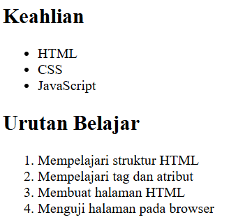
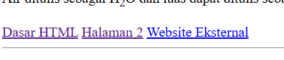
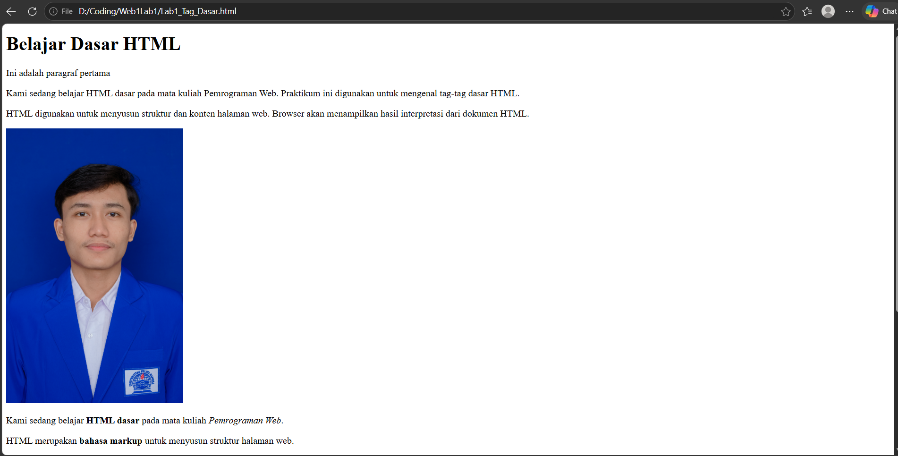
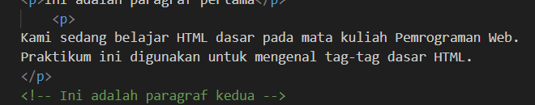
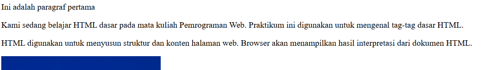

# LAB1WEB
## Belajar Tag Dasar HTML

### Membuat Paragraf
ini adalah hasil tampilan Web saya
Restu Aji Prasetyo
312510034
# Menambahkan Foto

Berikut adalah penjelasan lengkap untuk menjawab kesepuluh pertanyaan dasar mengenai HTML:

---

### 1. Fungsi Deklarasi `<!DOCTYPE html>` pada Dokumen HTML

Deklarasi `<!DOCTYPE html>` bukan merupakan tag HTML, melainkan sebuah instruksi (pemberitahuan) kepada browser web tentang jenis dokumen dan versi HTML apa yang digunakan (dalam hal ini, HTML5).

* **Fungsi utama:** Memastikan browser merender halaman web dalam **Standard Mode** (mode standar modern) alih-alih *Quirks Mode* (mode kompatibilitas lama yang dapat membuat tampilan web berantakan).

---

### 2. Perbedaan antara Tag, Elemen, dan Atribut pada HTML

* **Tag:** Penanda atau kode yang diapit oleh tanda kurung siku (contoh: `
`, `<a>`, `<h1>`). Tag biasanya berpasangan, yaitu tag pembuka (misal: `
`) dan tag penutup (misal: `
`).
* **Elemen:** Keseluruhan komponen dari tag pembuka, isi teks atau konten di dalamnya, hingga tag penutup.
* *Contoh:* `
Halo, dunia!
` adalah satu elemen paragraf yang utuh.

* **Atribut:** Informasi atau pengaturan tambahan yang diletakkan di dalam tag pembuka untuk memberikan detail khusus pada elemen tersebut.
* *Contoh:* `<a href="[https://google.com](https://google.com)">Google</a>` di mana `href="..."` adalah atributnya.

---

### 3. Perbedaan Tag ` ` dengan `
` serta Penggunaannya

* **Tag ` ` (Break):** Berfungsi untuk membuat baris baru (pindah baris/enter) di dalam teks tanpa membuat paragraf baru. Tag ini bersifat *self-closing* (tidak butuh tag penutup).
* *Penggunaan:* Cocok untuk alamat, puisi, atau lirik lagu di mana jarak antar baris sangat rapat.

* **Tag `
` (Paragraph):** Berfungsi untuk mengelompokkan sekumpulan teks menjadi satu blok paragraf. Tag ini memiliki jarak (margin) bawaan di atas dan di bawahnya.
* *Penggunaan:* Digunakan untuk menulis teks artikel, berita, atau blok narasi panjang.

---

### 4. Fungsi Atribut `href` pada Tag `<a>`

Atribut `href` (singkatan dari *Hypertext Reference*) pada tag `<a>` berfungsi untuk **menentukan alamat tujuan (URL atau path file)** dari tautan (link) yang akan dikunjungi ketika pengguna mengklik teks atau objek di dalam tag tersebut.

---

### 5. Perbedaan Hyperlink ke Halaman Internal dengan Eksternal

* **Hyperlink Internal:** Tautan yang mengarahkan pengguna ke halaman atau bagian lain **di dalam website yang sama**.
* *Contoh:* `<a href="tentang.html">Tentang Kami</a>` atau link ke bagian tertentu di halaman yang sama (`#kontak`).

* **Hyperlink Eksternal:** Tautan yang mengarahkan pengguna **ke luar website** menuju website atau domain yang berbeda.
* *Contoh:* `<a href="[https://www.wikipedia.org](https://www.wikipedia.org)">Wikipedia</a>`. Biasanya menggunakan URL lengkap yang diawali dengan `https://`.

---

### 6. Fungsi Atribut `src` dan `alt` pada Tag ``

* **Atribut `src` (Source):** Berfungsi untuk menentukan **lokasi atau path file gambar** yang ingin ditampilkan (bisa berupa URL online atau direktori file lokal).
* **Atribut `alt` (Alternative Text):** Berfungsi untuk memberikan **deskripsi teks alternatif** mengenai gambar tersebut. Teks ini akan muncul jika gambar gagal dimuat oleh browser, serta sangat penting bagi pembaca layar (*screen reader*) untuk tunanetra dan membantu optimasi SEO.

---

### 7. Perbedaan Penggunaan `<ul>` (Unordered List) dan `<ol>` (Ordered List)

* **`<ul>` (Unordered List):** Digunakan untuk membuat daftar item yang **tidak mementingkan urutan** angka. Secara default, item dalam list akan ditandai dengan titik bulat (*bullet*).
* *Contoh:* Daftar belanjaan (susu, roti, telur).

* **`<ol>` (Ordered List):** Digunakan untuk membuat daftar item yang **memerlukan urutan berurutan**, biasanya berupa angka atau huruf.
* *Contoh:* Langkah-langkah membuat kue atau daftar peringkat juara.
* *Catatan:* Keduanya menggunakan anak tag `<li>` (*list item*) di dalamnya.

---

### 8. Apa yang Terjadi jika Path Gambar pada Atribut `src` Salah?

Jika path file pada atribut `src` salah atau gambar tidak ditemukan, maka:

1. Gambar tidak akan muncul di halaman web.
2. Browser akan menampilkan ikon gambar rusak (*broken image icon*).
3. Jika atribut `alt` diisi, teks alternatif tersebut akan dimunculkan sebagai pengganti gambar yang gagal tampil.

---

### 9. Mengapa Struktur Heading (`<h1>` sampai `<h6>`) Perlu Digunakan Secara Berurutan?

Struktur heading perlu digunakan secara berurutan (dari `<h1>` sebagai judul utama, `<h2>` untuk sub-judul, hingga `<h6>` untuk sub-bagian terkecil) karena:

* **Aksesibilitas:** Membantu pengguna tunanetra yang menggunakan pembaca layar untuk memahami struktur dan navigasi halaman dengan mudah.
* **SEO (Search Engine Optimization):** Mesin pencari seperti Google mengandalkan hierarki heading untuk memahami topik utama dan konteks isi dokumen secara logis.
* **Keterbacaan:** Membuat dokumen lebih rapi, terstruktur, dan mudah dibaca oleh manusia.

---

### 10. Fungsi Komentar `<!-- ... -->` dalam Kode HTML

Komentar dalam HTML berfungsi sebagai **catatan atau keterangan pengingat** bagi pembuat kode (developer) yang ditulis di dalam file HTML.

* **Sifat:** Komentar **diabaikan oleh browser**, sehingga tidak akan tampil di halaman web yang dilihat oleh pengguna biasa.
* **Kegunaan:** Menjelaskan bagian kode tertentu, menonaktifkan kode sementara saat proses *debugging*, atau mempermudah pembagian bagian kode dalam tim pengembang.

---